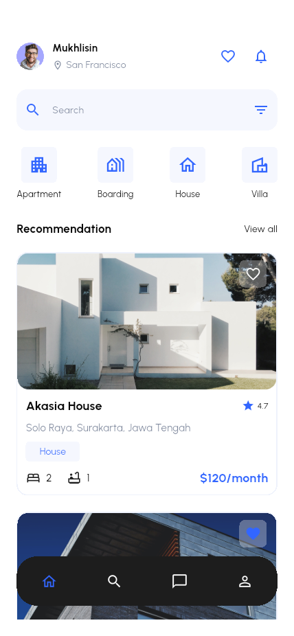
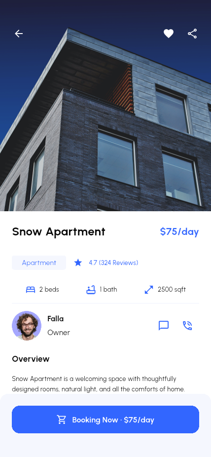
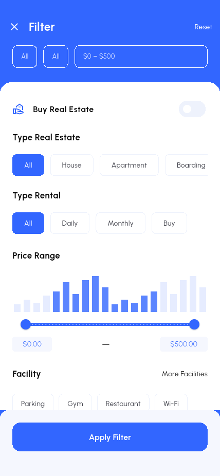
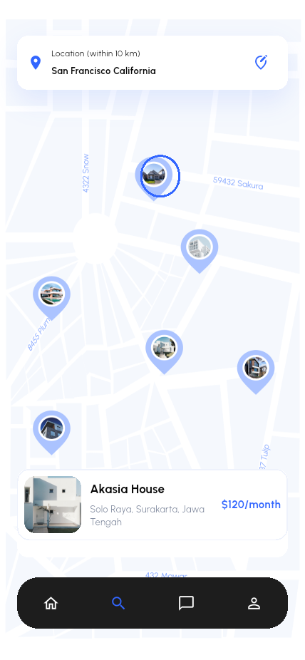
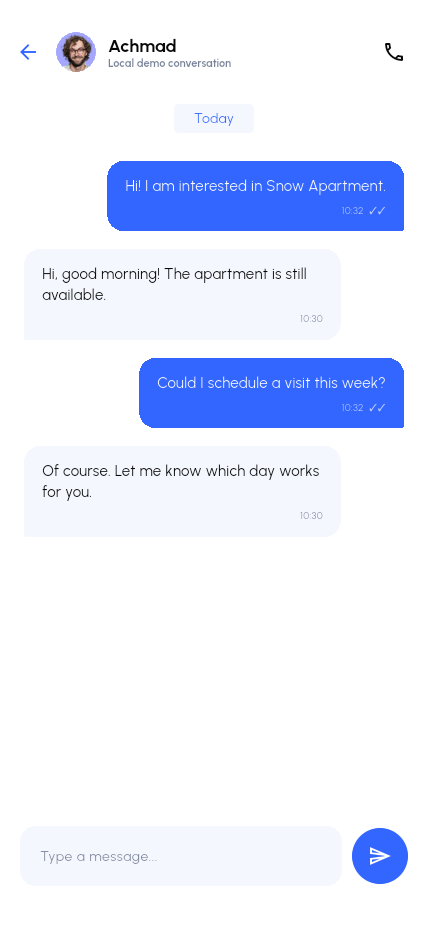
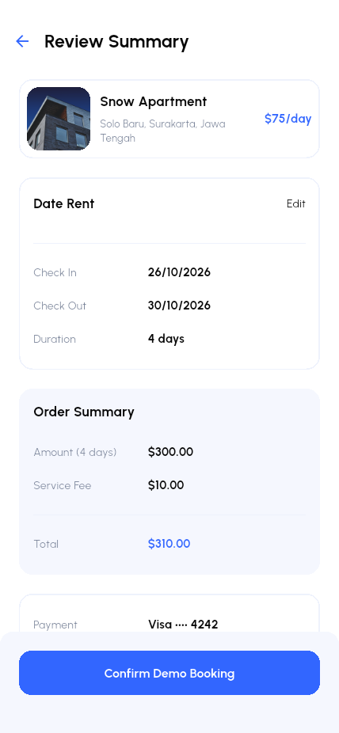
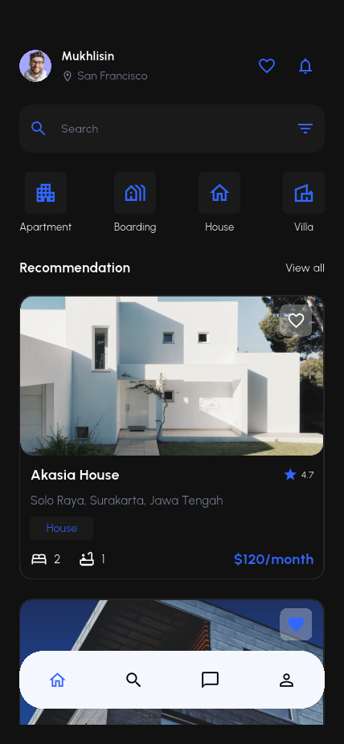
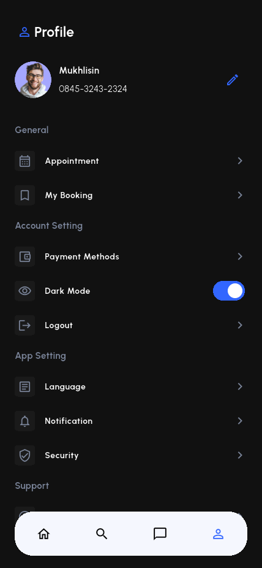
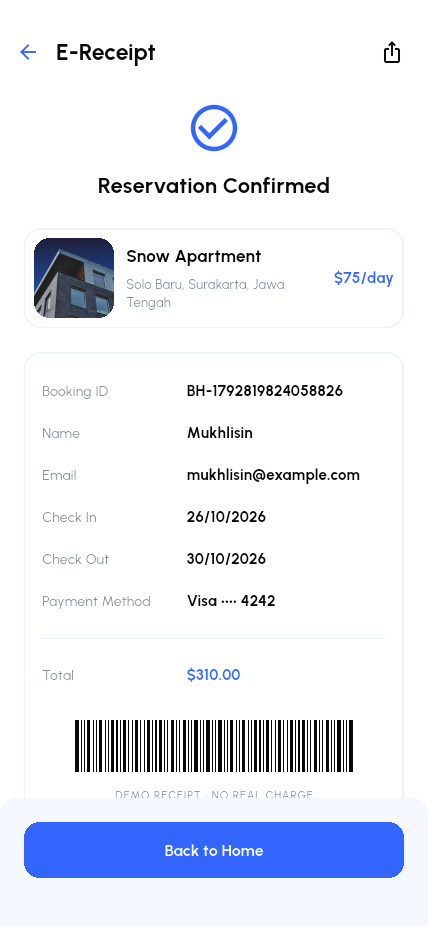

# Beta Home · Flutter 房产应用

根据 Pixso「Beta Home」设计实现的房产租赁与购买演示应用，提供浅色和深色主题。包含引导登录、房源发现、搜索筛选、收藏、房源详情、租购预约、订单凭证、消息和个人中心。

## 主要界面

以下图片来自 Android 模拟器中实际运行的 Flutter 应用。原稿图片单独保存在 [docs/design](docs/design/) 中。

| 首页 | 房源详情 | 搜索筛选 |
| --- | --- | --- |
|  |  |  |

| 地图找房 | 本地聊天 | 订单确认 |
| --- | --- | --- |
|  |  |  |

| 深色首页 | 深色个人中心 | 电子凭证 |
| --- | --- | --- |
|  |  |  |

全部界面见 [截图索引](docs/SCREENSHOTS.md)，设计对应关系见 [Pixso 画板映射](docs/DESIGN_MAPPING.md)。

## 快速运行

本次开发环境为 Flutter 3.47.7 / Dart 3.13.5。项目需要 Dart 3.13 或更高版本。

```powershell
flutter pub get
flutter devices
flutter run -d <设备ID>
```

使用本次建立的 Android 模拟器：

```powershell
flutter emulators --launch beta_home_review
flutter devices
flutter run -d emulator-5556
```

设备 ID 会随启动顺序变化，请以 `flutter devices` 输出为准。也可以使用 `flutter run -d chrome` 查看 Web 版本。iOS 工程需在 macOS 与 Xcode 环境中编译。

测试结束后可使用 `flutter build apk --release` 构建 Android 安装包，输出到 `build/app/outputs/flutter-apk/app-release.apk`。

## 演示方式

欢迎页可以直接选择 **Explore the local demo**，或使用任意格式正确的邮箱及不少于 6 位的演示密码登录。找回密码验证码是 **123456**，预约确认 PIN 是 **1234**。首次引导支持下一步与跳过。

推荐操作路径：

1. 首页浏览房源，点爱心保存收藏。
2. 点击搜索或筛选，按城市、房型、价格与设施查找。
3. 打开房源，查看照片、设施、评价和位置。
4. 选择租赁，填写日期和联系信息，选择付款方式，查看金额并确认。
5. 查看电子凭证，在个人中心的 My Booking 中再次打开。
6. 在 Message 发送本地消息；在 Profile 切换 Dark Mode、编辑资料和设置。

收藏、订单、聊天、资料、预约、主题和偏好设置会保存在本机。银行卡只保存末四位；不保存完整卡号、密码、CVV 或 PIN。

## 项目结构与架构

```text
lib/
├── main.dart       启动入口
├── app.dart        路由、主题与应用容器
├── domain/         房源、筛选、订单和消息模型
├── data/           本地存储仓储
├── state/          AppState 与状态通知
├── ui/             主题和复用控件
└── features/       auth / discovery / property / booking / explore / messages / account
```

采用 Flutter 原生 `ChangeNotifier` + `InheritedNotifier` 管理共享状态，命名路由管理页面，`SharedPreferences` 保存版本化 JSON。运行依赖仅一个 `shared_preferences`。表单、卡片、底栏、主题、租购订单步骤复用实现，避免按设计画板重复复制页面。

详见 [完整项目架构说明](docs/ARCHITECTURE.md)。

## 验证与截图

```powershell
flutter analyze
flutter test
$env:BETA_DEVICE_ID = "<Android设备ID>"
flutter drive --driver=test_driver/integration_test.dart --target=integration_test/app_test.dart -d <Android设备ID>
flutter drive --driver=test_driver/integration_test.dart --target=integration_test/screen_layout_test.dart -d <Android设备ID>
```

第一条 `flutter drive` 命令验证真实操作流程，并自动将所有界面的浅色、深色截图写入 `docs/screenshots/`；第二条检查不同屏宽下的页面布局。环境、实际结果与已知限制见 [测试记录](docs/TESTING.md)。

## 应用范围

这是完整的本地 UI 与交互演示，未连接生产后端。登录、验证码、支付、贷款、聊天和通话使用演示逻辑；地图为 Pixso 插画底图，不获取 GPS；语言页保存选择，界面文案保留原稿英文。不会产生真实扣款、房产交易、电话或消息发送。

如需接入真实服务，架构文档列出了对应的代码位置。Android 安装包使用开发签名，仅供演示安装。照片、头像、地图源自用户提供的 Pixso 设计；Urbanist 字体许可证见 [OFL.txt](assets/fonts/OFL.txt)。
