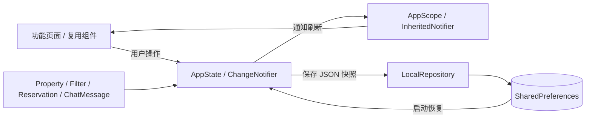

# Beta Home 项目架构

## 定位

根据 Pixso「Beta Home」房产应用设计实现的 Flutter 本地演示项目。包含浅色/深色主题、房源发现、预约、购买模拟、聊天、个人资料与设置。工程提供 Android、iOS、Web 平台入口；本次以 Android 模拟器作为运行验收平台。

## 目录

```text
BetaHome/
├── lib/
│   ├── main.dart                  # 启动、设备方向、读取本地存储
│   ├── app.dart                   # 应用主题、路由表
│   ├── domain/models.dart         # 房源、筛选、订单、消息模型与样例数据
│   ├── data/local_repository.dart # 版本化 JSON 本地读写
│   ├── state/app_state.dart       # 业务状态、搜索、金额、收藏、订单、持久化
│   ├── ui/
│   │   ├── theme.dart             # 颜色、字体、按钮、表单等设计规范
│   │   └── components.dart        # 页面骨架、房源卡片、底栏、输入/展示组件
│   └── features/
│       ├── auth/auth_pages.dart         # 引导、登录、注册、找回、资料初始化
│       ├── discovery/discovery_pages.dart # 首页、列表、搜索、筛选、收藏、通知
│       ├── property/property_pages.dart # 详情、分享、相册、评价
│       ├── booking/booking_pages.dart   # 租购、日历、付款、计算、订单与凭证
│       ├── explore/explore_pages.dart   # 演示位置、地图、房源选择
│       ├── messages/message_pages.dart  # 联系人、聊天、通话预览
│       └── account/account_pages.dart   # 个人中心、订单、设置、帮助
├── assets/
│   ├── images/                    # Pixso 导出的照片、头像、地图
│   └── fonts/                     # Urbanist 可变字体及 OFL 许可证
├── test/                          # 业务单元测试
├── integration_test/
│   ├── app_test.dart               # Android 操作流程与全页面截图
│   └── screen_layout_test.dart     # 窄屏/常规屏页面布局与表单巡检
├── test_driver/integration_test.dart # 将模拟器截图保存到 docs
├── docs/
│   ├── ARCHITECTURE.md            # 本文档
│   ├── DESIGN_MAPPING.md          # 76 个设计画板与应用页面对应表
│   ├── SCREENSHOTS.md             # 全页面浅色/深色截图索引
│   ├── TESTING.md                 # 验证环境与结果
│   ├── design/                    # 原稿导出图、节点清单
│   └── screenshots/{light,dark}/  # Android 实际运行截图
├── android/                       # Android 原生容器
├── ios/                           # iOS 原生容器
├── web/                           # Web 入口
└── pubspec.yaml                   # 依赖与资源声明
```

## 数据与界面关系



仅使用 Flutter 原生 `ChangeNotifier`、`InheritedNotifier` 和命名路由；第三方运行依赖只有 `shared_preferences`。页面内部短期状态（表单输入、当前日历月份、排序选择）放在 `StatefulWidget` 中，跨页面数据由 `AppState` 管理。

## 主要流程

```text
启动 → 引导 → 欢迎 → 登录 / 注册 → 个人资料 → 演示 PIN → 首页
首页 → 搜索 / 分类 / 筛选 → 房源列表 → 房源详情
详情 → 租赁方式 → 选择日期 → 联系信息 → 付款方式 → 订单确认
     → PIN 1234 → 完成 → 电子凭证 → 我的订单
详情 → 购买方式 → 费用 / 贷款试算 → 预约看房 → 付款 → 确认
消息 → 选择联系人 → 本地聊天 / 通话预览
个人中心 → 编辑资料 / 订单 / 预约 / 付款方式 / 设置 / 帮助
```

## 业务规则

- 搜索支持房源名称、房型与地址；与房型、价格和设施筛选共同生效。
- 每日房源按入住到退房的天数计价；每月房源按 30 天一个计费月向上取整。租赁服务费为演示固定值 10 美元。
- 购买流程按原稿展示的 54,723 美元示例价格与 2.5% 示例税率计算。贷款试算使用标准等额本息公式；利率为 0 时直接按期数平摊。
- 可选择未来入住/退房日期，退房晚于入住；日历同时用于预约看房。
- 订单保存确认时的房源、日期、金额、付款方式、备注等快照，后续浏览其他房源不会改变历史订单。
- 全卡号、CVV、密码、PIN 均不写入本地存储；银行卡只保存脱敏名称与末四位。

## 保存与恢复

使用 `beta_home.v1` 作为本地键，串行保存快照，包含主题、会话偏好、个人资料、收藏、聊天、订单、预约、银行卡末四位、语言与开关设置。退出登录仅退出本地演示会话，保留设备上的收藏与订单。搜索条件和当前操作步骤属于临时状态。

`LocalRepository` 对无效 JSON 回退为默认数据；订单逐项解析，旧版或无效订单不阻断其他内容加载。生产环境应将账号数据按用户隔离，并采用认证服务与后端数据库。

## 接入真实服务的位置

| 真实能力 | 建议接入位置 |
| --- | --- |
| 房源接口、分页、实时价格 | `domain/models.dart` 的样例数据替换为仓储返回值，`AppState.results` 扩展为异步查询 |
| 登录、验证码、会话 | `features/auth` 的提交处理与独立认证仓储，令牌保存到系统安全存储 |
| 地图与 GPS | `features/explore` 更换地图组件，接入定位授权与坐标查询 |
| 支付 | `PaymentPage` 与 `confirmBooking` 之间加入支付 SDK、服务器订单确认与幂等处理 |
| 聊天、推送、通话 | `features/messages` 接入实时消息/音视频，通知设置对接推送服务 |
| 多语言 | 使用 `flutter_localizations`、ARB 与生成的 `AppLocalizations` 替换界面文案 |

## 代码精简原则

76 个画板中的空白、输入中、填写完成状态共享页面；深色模式使用统一主题。房源大小卡片、页面布局、底部操作、信息行、标签、头像和筛选选项集中复用。租购流程共用付款、PIN、成功、凭证页面，避免为每张设计稿复制代码。没有引入路由框架、状态管理框架、网络图片依赖或重复服务层。
